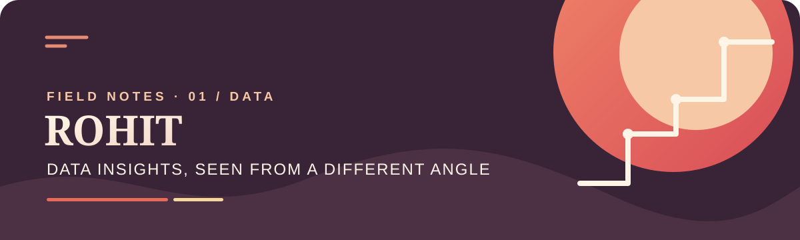

## Data analyst · aspiring data scientist

I’m **Rohit**, building my path in data analytics and data science. I’m interested in making complex information easier to understand—through thoughtful analysis, clear visualizations, and practical storytelling.

> **My approach:** ask a better question → explore the evidence → communicate the insight.

---

## About

- **Focus:** data analysis, visualization, and the foundations of data science
- **Working toward:** a strong, project-led portfolio and deeper applied machine-learning skills
- **What I value:** careful problem framing, reproducible work, and communicating findings clearly
- **Currently learning:** Python-based analysis, SQL, and machine-learning fundamentals

---

## Analytics toolkit

*Tools and areas I’m building with; this is a learning-focused toolkit, not a claim of certification or mastery.*

  
  
  
  
  
  
  

---

## Selected work

I haven’t published analytics projects on this profile yet. I’m developing a portfolio that demonstrates the full workflow—from asking a useful question and preparing data to analysis, visualization, and communicating a clear outcome.

**Explore my repositories:** [github.com/R-ohit-kr](https://github.com/R-ohit-kr)

*As projects are published, this section will highlight the question, methods, tools, and outcome for each one.*

---

## GitHub activity

 

*Stats and activity are generated from GitHub and may take a little time to update.*

---

## Certifications & achievements

I haven’t listed certifications or formal achievements here because none have been shared for verification. This section will be updated as I earn and document relevant credentials and milestones.

---

## Learning & direction

I’m strengthening my foundations in **data analysis, SQL, Python, data visualization, and applied machine learning**. My goal is to build useful, well-documented projects that connect sound analysis with clear communication.

---

## Connect

I’m open to learning, thoughtful collaboration, and entry-level opportunities in data analytics. The links below are placeholders until I add verified contact details:

- **LinkedIn:** https://www.linkedin.com/in/rohit-kumar-65419a369/
- **Portfolio:** [Add portfolio URL]
- **Email:** rohitkr104232gmail.com

---

  Thoughtful analysis. Clear communication. Better decisions.

